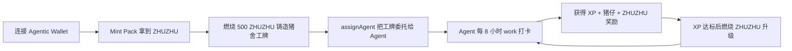
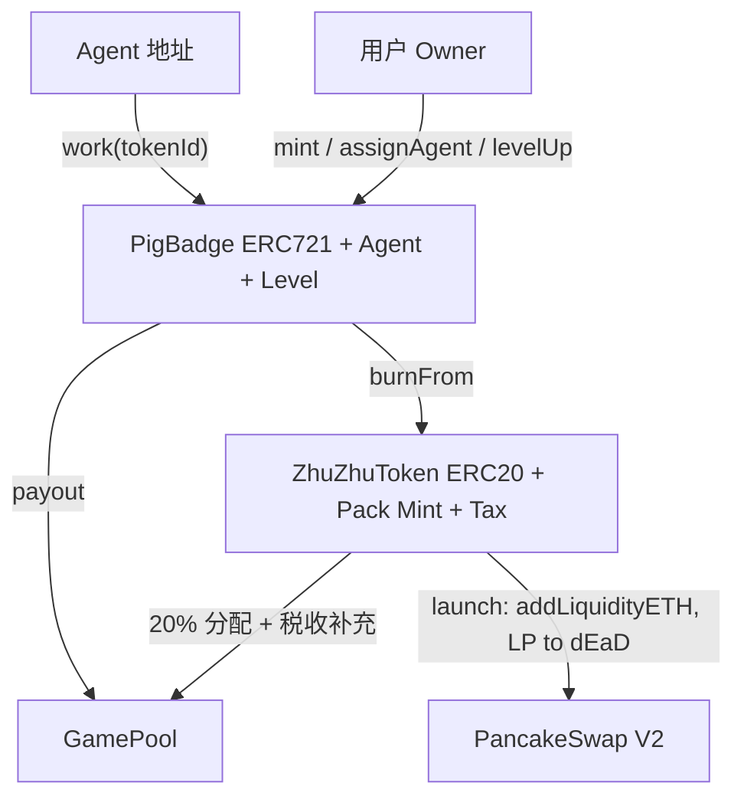

# 🐷 猪猪币 ZhuZhu Agent：完整项目方案

> 你躺平，Agent 养猪 · You lie flat, Agent raises pigs.

> [!IMPORTANT]
> “Binance Agentic Wallet / .ai Agent ID” 的具体接口（SDK、签名格式、身份注册表合约）以 Binance 官方文档为准。本方案按通用方式设计：**Agent = 一个链上地址（EOA 或 ERC-4337 智能账户）**，合约里不写死任何钱包厂商逻辑，所以不管 Agent 钱包怎么实现都能接入。

---

## 1. 项目定位

| 项目 | 内容 |
|---|---|
| 项目名 | 猪猪币 / ZhuZhu Agent |
| Ticker | `$ZHUZHU` |
| NFT | 猪舍工牌 Pig Pen Badge（`PIGBADGE`） |
| 链 | BNB Smart Chain (BSC) |
| Slogan（中） | 你躺平，Agent 养猪。 |
| Slogan（英） | You lie flat, Agent raises pigs. |

**核心叙事（约 200 字）**

打工人卷不动了，可猪还得有人养。猪猪币是 BSC 上第一个“AI 代养猪”的 Meme 实验：你用 Binance Agentic Wallet 铸造 `$ZHUZHU`，换一张“猪舍工牌 NFT”，再把工牌交给你的 AI Agent。之后你只管躺平，Agent 会按时上链打卡、喂猪、清猪圈、攒经验，从养猪学徒一路升到终极猪皇。每一次打卡都在链上可查，每一次升级都要燃烧猪猪币，猪越养越多，币越烧越少。人负责躺，Agent 负责卷，猪负责胖。DeFAI 不一定非要高深，先从养好一头猪开始。

---

## 2. 玩法流程



### 2.1 铸造猪猪币（Pack 模式）

| 参数 | 数值 |
|---|---|
| 每 Pack | 1,000 ZHUZHU |
| 价格 | 0.01 BNB / Pack |
| 总量 | 10,000 Pack（共 1,000 万枚，占总量 50%） |
| 单地址上限 | 10 Pack |
| 预计募集 | 100 BNB（满额时） |
| 铸造期 | 72 小时，满额或到期后任何人可调用 `launch()` 开盘 |

**BNB 去向（合约里写死）：** 80% 进 LP，5% 给推荐人，10% 进回购基金，5% 运营。

**推荐机制：**
- 推荐链接：`zhuzhu.xyz/mint?ref=0x...`
- 推荐人自己至少铸过 1 Pack 才能生效，只算一级，第一次绑定后不能改
- 推荐人拿到被推荐人铸造金额的 5%，记在合约里，自己调用 `claimRefReward()` 领取（pull 模式）
- 开盘前代币不能转账，防止在开盘前私下交易或抢先加池

### 2.2 铸造猪舍工牌 NFT

- 燃烧 **500 ZHUZHU** 铸造 1 张工牌（直接通缩）
- 总量 10,000 张，每个地址最多持有 3 张
- 初始状态：Lv1 养猪学徒、0 XP、1 头猪仔
- 工牌可以转让或在市场上交易；**一旦转手，原来的 Agent 授权自动清空**

### 2.3 把工牌交给 Agent

“交给 Agent”是**委托操作权**，不是把 NFT 转给 Agent：

1. 用户（工牌所有者）调用 `assignAgent(tokenId, agentAddress)`
2. Agent 只能调用 `work(tokenId)`，**不能转走、卖掉或升级工牌**
3. **奖励永远发给工牌的所有者**，不会发到 Agent 地址
4. 用户可以随时调用 `revokeAgent(tokenId)` 收回授权
5. 可选的进阶做法：后端用 EIP-712 签名证明这个地址确实绑定了某个 .ai Agent ID，再调用 `assignAgentWithSig`（防女巫，并给已认证 Agent 加 10% 奖励）

### 2.4 职业 / 等级

| 等级 | 职业 | 升到下一级需要的 XP | 升级燃烧 | 产出倍率 | 每次打卡加猪仔 |
|---|---|---|---|---|---|
| Lv1 | 🐽 养猪学徒 Piglet Intern | 100 | 1,000 | 1.00x | +1 |
| Lv2 | 🧹 猪舍工人 Pen Worker | 300 | 3,000 | 1.25x | +2 |
| Lv3 | 📋 猪场主管 Farm Supervisor | 800 | 8,000 | 1.50x | +3 |
| Lv4 | 🏭 区域猪老板 Regional Pig Boss | 2,000 | 20,000 | 2.00x | +5 |
| Lv5 | 👑 终极猪皇 Pig Emperor | — | — | 3.00x | +8 |

- 每次打卡 +10 XP；连续打卡（每次间隔不超过 24 小时）每多一次加 2% 奖励，最多 +20%
- 升级由**用户自己确认**（因为要燃烧代币），Agent 只能负责打卡

### 2.5 Agent 养猪会产出什么

- **ZHUZHU 奖励**：基础 10 ZHUZHU × 等级倍率 × 连续打卡加成，从游戏池里发放
- **每日总量上限**：全网每天最多发 4,000 ZHUZHU，发完当天就没有了，保证游戏池能撑大约 1,000 天以上（交易税还会给它补充）
- **猪仔数量 pigs**：链上记录的养殖规模，用来做排行榜、空投权重和后续玩法（比如猪肉市场、配种）
- **XP**：用来升级

---

## 3. Tokenomics（总量 20,000,000）

| 分配 | 比例 | 数量 | 说明 |
|---|---|---|---|
| 公开 Pack 铸造 | 50% | 10,000,000 | 0.01 BNB / 1000 枚 |
| 流动性 LP | 20% | 4,000,000 | 和 80% 募集的 BNB 一起加池 |
| 游戏池 Game Pool | 20% | 4,000,000 | 只有工牌合约能按每日上限领取 |
| 团队 | 5% | 1,000,000 | VestingWallet：锁 3 个月后，12 个月线性释放 |
| 市场 / 空投 | 5% | 1,000,000 | 白名单任务、KOL、活动 |

**LP 处理：**
- `launch()` 一步完成加池，LP Token 直接打到 `0x...dEaD`，**永久销毁**
- 如果没铸满：LP 的代币按卖出比例等比缩减（保证开盘价格和铸造价格的关系不变），没卖掉的代币全部销毁
- 开盘价约为铸造价的 2 倍（4M 代币 : 80 BNB，铸造价是 10M : 100 BNB）

**买卖税（只对 Pancake pair 生效，普通转账不收）：**

| 类型 | 税率 | 去向 |
|---|---|---|
| 买入 | 1% | 100% 补充游戏池 |
| 卖出 | 3% | 1.5% 直接销毁 + 1.5% 补充游戏池 |

- 合约硬编码**单边税率上限 5%**，而且 `setTaxes` **只能下调、不能上调**
- **回购销毁**：10% 的募集 BNB 进回购基金，由 `buybackAndBurn()` 在 Pancake 上买入 ZHUZHU，直接打进黑洞地址；建议每周公开执行一次，并公布交易哈希
- 其他通缩：铸造工牌燃烧 500、升级燃烧 1,000 到 20,000

---

## 4. 技术实现

### 4.1 合约架构



基于 Solidity `^0.8.24` 和 OpenZeppelin v5。团队份额直接用 OZ 的 `VestingWalletCliff`。

### 4.2 ZhuZhuToken.sol（ERC20 + Pack Mint + 税）

```solidity
// SPDX-License-Identifier: MIT
pragma solidity ^0.8.24;

import {ERC20} from "@openzeppelin/contracts/token/ERC20/ERC20.sol";
import {ERC20Burnable} from "@openzeppelin/contracts/token/ERC20/extensions/ERC20Burnable.sol";
import {Ownable} from "@openzeppelin/contracts/access/Ownable.sol";
import {ReentrancyGuard} from "@openzeppelin/contracts/utils/ReentrancyGuard.sol";

interface IPancakeRouter02 {
    function factory() external pure returns (address);
    function WETH() external pure returns (address);
    function addLiquidityETH(address token, uint amountTokenDesired, uint amountTokenMin,
        uint amountETHMin, address to, uint deadline) external payable returns (uint, uint, uint);
    function swapExactETHForTokensSupportingFeeOnTransferTokens(uint amountOutMin,
        address[] calldata path, address to, uint deadline) external payable;
}
interface IPancakeFactory {
    function getPair(address, address) external view returns (address);
    function createPair(address, address) external returns (address);
}

contract ZhuZhuToken is ERC20, ERC20Burnable, Ownable, ReentrancyGuard {
    // ---- 分配 ----
    uint256 public constant MINT_ALLOC = 10_000_000 ether;
    uint256 public constant LP_ALLOC   =  4_000_000 ether;
    uint256 public constant GAME_ALLOC =  4_000_000 ether;
    uint256 public constant TEAM_ALLOC =  1_000_000 ether;
    uint256 public constant MKT_ALLOC  =  1_000_000 ether;

    // ---- Pack ----
    uint256 public constant TOKENS_PER_PACK = 1_000 ether;
    uint256 public constant PACK_PRICE = 0.01 ether;
    uint256 public constant MAX_PACKS = 10_000;
    uint256 public constant MAX_PACKS_PER_WALLET = 10;
    uint256 public constant REF_BPS = 500;       // 5%
    uint256 public constant LP_BPS = 8000;       // 80%
    uint256 public constant BUYBACK_BPS = 1000;  // 10%，剩余为运营

    // ---- 税 ----
    uint256 public constant MAX_TAX_BPS = 500;
    uint256 public buyTaxBps = 100;
    uint256 public sellTaxBps = 300;
    address public constant DEAD = 0x000000000000000000000000000000000000dEaD;

    IPancakeRouter02 public immutable router;
    address public immutable gamePool;
    address public pair;
    uint256 public immutable mintEnd;
    bool public tradingOpen;

    uint256 public packsSold;
    uint256 public lpBnb;
    uint256 public buybackBnb;
    uint256 public opsBnb;
    mapping(address => uint256) public packsOf;
    mapping(address => address) public referrerOf;
    mapping(address => uint256) public refRewards;
    mapping(address => bool) public isExempt;

    event PacksMinted(address indexed user, uint256 packs, address indexed ref);
    event Launched(uint256 tokens, uint256 bnb, address pair);
    event BuybackBurn(uint256 bnbIn);

    constructor(address _router, address _gamePool, address _teamVesting, address _marketing)
        ERC20("ZhuZhu Coin", "ZHUZHU") Ownable(msg.sender)
    {
        router = IPancakeRouter02(_router);
        gamePool = _gamePool;
        mintEnd = block.timestamp + 72 hours;
        _mint(address(this), MINT_ALLOC + LP_ALLOC);
        _mint(_gamePool, GAME_ALLOC);
        _mint(_teamVesting, TEAM_ALLOC);
        _mint(_marketing, MKT_ALLOC);
        isExempt[address(this)] = true;
        isExempt[_gamePool] = true;
        isExempt[_marketing] = true;
    }

    // ================= Pack Mint =================
    function mintPacks(uint256 packs, address ref) external payable nonReentrant {
        require(!tradingOpen && block.timestamp < mintEnd, "mint closed");
        require(packs > 0, "zero");
        require(packsSold + packs <= MAX_PACKS, "sold out");
        require(packsOf[msg.sender] + packs <= MAX_PACKS_PER_WALLET, "wallet cap");
        require(msg.value == packs * PACK_PRICE, "bad value");

        if (referrerOf[msg.sender] == address(0) && ref != address(0)
            && ref != msg.sender && packsOf[ref] > 0) {
            referrerOf[msg.sender] = ref;
        }
        address r = referrerOf[msg.sender];
        uint256 refCut = r == address(0) ? 0 : msg.value * REF_BPS / 10_000;
        uint256 lpCut = msg.value * LP_BPS / 10_000;
        uint256 bbCut = msg.value * BUYBACK_BPS / 10_000;
        if (refCut > 0) refRewards[r] += refCut;
        lpBnb += lpCut;
        buybackBnb += bbCut;
        opsBnb += msg.value - refCut - lpCut - bbCut;

        packsSold += packs;
        packsOf[msg.sender] += packs;
        _transfer(address(this), msg.sender, packs * TOKENS_PER_PACK);
        emit PacksMinted(msg.sender, packs, r);
    }

    function claimRefReward() external nonReentrant {
        uint256 amt = refRewards[msg.sender];
        require(amt > 0, "none");
        refRewards[msg.sender] = 0;
        (bool ok,) = msg.sender.call{value: amt}("");
        require(ok, "transfer failed");
    }

    // ================= Launch =================
    /// 满额或到期后任何人都可以调用；LP Token 打入黑洞
    function launch() external nonReentrant {
        require(!tradingOpen, "launched");
        require(packsSold == MAX_PACKS || block.timestamp >= mintEnd, "not yet");
        require(packsSold > 0, "no mint");

        uint256 lpTokens = LP_ALLOC * packsSold / MAX_PACKS;
        uint256 unsold = (MAX_PACKS - packsSold) * TOKENS_PER_PACK + (LP_ALLOC - lpTokens);
        if (unsold > 0) _burn(address(this), unsold);

        IPancakeFactory f = IPancakeFactory(router.factory());
        address p = f.getPair(address(this), router.WETH());
        if (p == address(0)) p = f.createPair(address(this), router.WETH());
        pair = p;

        uint256 bnb = lpBnb;
        lpBnb = 0;
        _approve(address(this), address(router), lpTokens);
        router.addLiquidityETH{value: bnb}(address(this), lpTokens, lpTokens, bnb, DEAD, block.timestamp);
        tradingOpen = true;
        emit Launched(lpTokens, bnb, p);
    }

    // ================= 回购销毁 =================
    function buybackAndBurn(uint256 bnbAmount, uint256 minOut) external onlyOwner nonReentrant {
        require(tradingOpen && bnbAmount <= buybackBnb, "invalid");
        buybackBnb -= bnbAmount;
        address[] memory path = new address[](2);
        path[0] = router.WETH();
        path[1] = address(this);
        router.swapExactETHForTokensSupportingFeeOnTransferTokens{value: bnbAmount}(
            minOut, path, DEAD, block.timestamp);
        emit BuybackBurn(bnbAmount);
    }

    function withdrawOps(address to) external onlyOwner nonReentrant {
        uint256 amt = opsBnb;
        opsBnb = 0;
        (bool ok,) = to.call{value: amt}("");
        require(ok, "transfer failed");
    }

    /// 只能下调，不能上调
    function setTaxes(uint256 buyBps, uint256 sellBps) external onlyOwner {
        require(buyBps <= buyTaxBps && sellBps <= sellTaxBps, "only lower");
        buyTaxBps = buyBps;
        sellTaxBps = sellBps;
    }

    // ================= 转账 Hook =================
    function _update(address from, address to, uint256 value) internal override {
        if (from == address(0) || to == address(0)) { super._update(from, to, value); return; }
        if (!tradingOpen) require(isExempt[from] || isExempt[to], "pig pen closed");

        uint256 fee;
        bool isBuy = from == pair && pair != address(0);
        bool isSell = to == pair && pair != address(0);
        if (tradingOpen && !isExempt[from] && !isExempt[to]) {
            if (isBuy) fee = value * buyTaxBps / 10_000;
            else if (isSell) fee = value * sellTaxBps / 10_000;
        }
        if (fee > 0) {
            if (isSell) {
                uint256 burnPart = fee / 2;
                super._update(from, address(0), burnPart);     // 销毁
                super._update(from, gamePool, fee - burnPart); // 补充游戏池
            } else {
                super._update(from, gamePool, fee);
            }
            value -= fee;
        }
        super._update(from, to, value);
    }

    receive() external payable {} // 接收 router 退回的 BNB
}
```

### 4.3 GamePool.sol

```solidity
// SPDX-License-Identifier: MIT
pragma solidity ^0.8.24;

import {IERC20} from "@openzeppelin/contracts/token/ERC20/IERC20.sol";
import {SafeERC20} from "@openzeppelin/contracts/token/ERC20/utils/SafeERC20.sol";
import {Ownable} from "@openzeppelin/contracts/access/Ownable.sol";

contract GamePool is Ownable {
    using SafeERC20 for IERC20;
    IERC20 public token;
    address public distributor; // PigBadge

    constructor() Ownable(msg.sender) {}

    /// 只能设置一次，设置完建议 renounceOwnership
    function init(address _token, address _distributor) external onlyOwner {
        require(address(token) == address(0), "inited");
        token = IERC20(_token);
        distributor = _distributor;
    }

    function payout(address to, uint256 amount) external returns (uint256 paid) {
        require(msg.sender == distributor, "not distributor");
        uint256 bal = token.balanceOf(address(this));
        paid = amount > bal ? bal : amount;
        if (paid > 0) token.safeTransfer(to, paid);
    }
}
```

### 4.4 PigBadge.sol（ERC721 + Agent 委托 + 等级）

```solidity
// SPDX-License-Identifier: MIT
pragma solidity ^0.8.24;

import {ERC721} from "@openzeppelin/contracts/token/ERC721/ERC721.sol";
import {Ownable} from "@openzeppelin/contracts/access/Ownable.sol";
import {ReentrancyGuard} from "@openzeppelin/contracts/utils/ReentrancyGuard.sol";

interface IZhuZhu { function burnFrom(address account, uint256 value) external; }
interface IGamePool { function payout(address to, uint256 amount) external returns (uint256); }

contract PigBadge is ERC721, Ownable, ReentrancyGuard {
    struct Badge {
        uint8 level;       // 1-5
        uint32 xp;
        uint32 pigs;
        uint32 streak;
        uint64 lastWorkAt;
        address agent;
    }

    IZhuZhu public immutable zhuzhu;
    IGamePool public immutable pool;

    uint256 public constant MAX_SUPPLY = 10_000;
    uint256 public constant MAX_PER_WALLET = 3;
    uint256 public constant MINT_BURN = 500 ether;
    uint256 public constant WORK_COOLDOWN = 8 hours;
    uint256 public constant STREAK_WINDOW = 24 hours;
    uint256 public constant XP_PER_WORK = 10;
    uint256 public constant BASE_REWARD = 10 ether;
    uint256 public constant DAILY_CAP = 4_000 ether;

    uint32[6]  public xpToNext   = [0, 100, 300, 800, 2000, 0];
    uint256[6] public upgradeBurn = [0, 1_000 ether, 3_000 ether, 8_000 ether, 20_000 ether, 0];
    uint16[6]  public multBps    = [0, 10_000, 12_500, 15_000, 20_000, 30_000];
    uint8[6]   public pigsPerWork = [0, 1, 2, 3, 5, 8];

    uint256 public nextId = 1;
    uint256 public currentDay;
    uint256 public emittedToday;
    mapping(uint256 => Badge) public badges;

    event AgentAssigned(uint256 indexed id, address indexed agent);
    event AgentRevoked(uint256 indexed id);
    event Worked(uint256 indexed id, address indexed agent, uint256 reward, uint32 xp, uint32 pigs);
    event LevelUp(uint256 indexed id, uint8 newLevel);

    constructor(address _zhuzhu, address _pool) ERC721("Pig Pen Badge", "PIGBADGE") Ownable(msg.sender) {
        zhuzhu = IZhuZhu(_zhuzhu);
        pool = IGamePool(_pool);
    }

    modifier onlyBadgeOwner(uint256 id) {
        require(ownerOf(id) == msg.sender, "not owner");
        _;
    }

    // ---- 铸造：燃烧 500 ZHUZHU（需要先 approve）----
    function mint() external nonReentrant returns (uint256 id) {
        require(nextId <= MAX_SUPPLY, "sold out");
        require(balanceOf(msg.sender) < MAX_PER_WALLET, "wallet cap");
        zhuzhu.burnFrom(msg.sender, MINT_BURN);
        id = nextId++;
        badges[id] = Badge({level: 1, xp: 0, pigs: 1, streak: 0, lastWorkAt: 0, agent: address(0)});
        _safeMint(msg.sender, id);
    }

    // ---- Agent 委托 ----
    function assignAgent(uint256 id, address agent) external onlyBadgeOwner(id) {
        require(agent != address(0), "zero");
        badges[id].agent = agent;
        emit AgentAssigned(id, agent);
    }

    function revokeAgent(uint256 id) external onlyBadgeOwner(id) {
        delete badges[id].agent;
        emit AgentRevoked(id);
    }

    // ---- Agent 打卡养猪 ----
    function work(uint256 id) external nonReentrant {
        Badge storage b = badges[id];
        require(b.agent != address(0) && msg.sender == b.agent, "not agent");
        require(block.timestamp >= b.lastWorkAt + WORK_COOLDOWN, "pigs are sleeping");

        b.streak = (b.lastWorkAt != 0 && block.timestamp <= b.lastWorkAt + STREAK_WINDOW) ? b.streak + 1 : 1;
        b.lastWorkAt = uint64(block.timestamp);
        b.xp += uint32(XP_PER_WORK);
        b.pigs += pigsPerWork[b.level];

        uint256 streakBonus = b.streak > 10 ? 2_000 : (b.streak - 1) * 200; // 最多 +20%
        uint256 reward = BASE_REWARD * multBps[b.level] / 10_000 * (10_000 + streakBonus) / 10_000;

        uint256 today = block.timestamp / 1 days;
        if (today != currentDay) { currentDay = today; emittedToday = 0; }
        if (emittedToday + reward > DAILY_CAP) reward = DAILY_CAP - emittedToday;
        uint256 paid = reward > 0 ? pool.payout(ownerOf(id), reward) : 0; // 奖励发给 owner
        emittedToday += paid;

        emit Worked(id, msg.sender, paid, b.xp, b.pigs);
    }

    // ---- 升级：只能由 owner 操作 ----
    function levelUp(uint256 id) external onlyBadgeOwner(id) nonReentrant {
        Badge storage b = badges[id];
        require(b.level < 5, "max level");
        require(b.xp >= xpToNext[b.level], "need more xp");
        zhuzhu.burnFrom(msg.sender, upgradeBurn[b.level]);
        b.xp -= xpToNext[b.level];
        b.level += 1;
        emit LevelUp(id, b.level);
    }

    // ---- 转手时自动清空 Agent 授权 ----
    function _update(address to, uint256 id, address auth) internal override returns (address from) {
        from = super._update(to, id, auth);
        if (from != address(0) && from != to && badges[id].agent != address(0)) {
            delete badges[id].agent;
            emit AgentRevoked(id);
        }
    }
}
```

> [!NOTE]
> 进阶：`assignAgentWithSig(id, agent, agentIdHash, deadline, sig)`，由项目后端的 signer 用 EIP-712 签名证明这个 agent 地址绑定了某个 .ai Agent ID；合约验证签名（用 OZ 的 `EIP712` + `ECDSA`），并记一个 `verified` 标记，打卡时多给 10%。

### 4.5 支持 Binance Agent Wallet 的要点

- **不要用 `tx.origin == msg.sender` 做防机器人检查**，否则智能账户形式的 Agent 钱包会被直接拒绝
- 所有关键函数只依赖 `msg.sender`，所以 EOA 和 ERC-4337 智能账户都能用
- 给 Agent 提供一份**工具描述**（MCP tool 或 function-calling JSON），让 Agent 自己判断什么时候调用：

```json
{
  "name": "zhuzhu_work",
  "description": "为猪舍工牌打卡养猪。只有 cooldown 结束后才能调用。",
  "contract": "PigBadge",
  "method": "work(uint256)",
  "precheck": "badges(id).lastWorkAt + 28800 <= now && badges(id).agent == self",
  "params": { "id": "uint256 工牌编号" }
}
```

### 4.6 部署顺序

1. 部署 `GamePool`
2. 部署 `VestingWalletCliff(team, start, 365 days, 90 days)`
3. 部署 `ZhuZhuToken(router, gamePool, vesting, marketing)`
4. 部署 `PigBadge(token, gamePool)`
5. 调用 `GamePool.init(token, badge)`，再 `renounceOwnership`
6. 在 BscScan 上验证所有合约源码，并做第三方审计

PancakeSwap V2 Router（BSC 主网）：`0x10ED43C718714eb63d5aA57B78B54704E256024E`（部署前请再到官方文档核对一遍）

### 4.7 前端技术栈

| 层 | 选型 |
|---|---|
| 框架 | Next.js 15（App Router）+ TypeScript |
| 链交互 | wagmi v2 + viem + Reown AppKit / RainbowKit（接入 Binance Wallet 连接器） |
| UI | Tailwind CSS + shadcn/ui + Framer Motion（猪猪动画）+ Lottie |
| 索引 | The Graph / Goldsky subgraph（Worked、LevelUp、PacksMinted 事件） |
| Agent Runner | Node.js + viem 定时任务，或者交给 Binance Agentic Wallet 自己托管的 Agent 执行 |
| 合约开发 | Foundry（forge test / fuzz）+ Slither |

### 4.8 安全注意事项

- **Launch 抢跑 / 捐赠攻击**：攻击者可以先创建 pair，往里面打 WBNB 再调用 `sync`，让 `addLiquidityETH` 失败。生产版建议在 `launch` 里直接把代币和 WBNB 转进 pair，再调用 `pair.mint(DEAD)`，而不是走 router
- **开盘狙击**：可以在开盘后前 N 个区块限制单笔和单个钱包的最大持仓，过了这段时间自动失效（写死，不留开关）
- **税率**：硬编码上限，只能下调；不要设黑名单，也不要留暂停交易的开关（避免被认为是貔貅盘）
- **随机事件**（比如母猪产仔暴击）：用 Chainlink VRF，不要用 `block.prevrandao` 或 `blockhash`
- **Reentrancy**：BNB 转账统一用 pull 模式 + `nonReentrant`
- **Owner 权限最小化**：开盘后把 owner 换成多签（Safe）+ Timelock
- **女巫攻击**：单地址上限只能挡住普通用户，配合 Agent ID 签名认证一起用
- 上线前：Foundry 单测 + fuzz、Slither 扫描、BSC Testnet 公测、第三方审计

---

## 5. 前端页面结构与文案

### 5.1 首页 `/`
- **Hero**：大字 “你躺平，Agent 养猪。” / “You lie flat, Agent raises pigs.”
- 副标题：BSC 上第一个 AI 代养猪 Meme。铸币 → 领工牌 → 交给 Agent → 躺平看猪长肉。
- 按钮：`🐷 立即铸造 Mint Now` · `📖 白皮书`
- 实时数据条：已售 Pack / 10,000 · 已铸工牌 · 全网猪仔总数 · 累计销毁 ZHUZHU
- 三步卡片：① 铸造猪猪币 ② 领取猪舍工牌 ③ 委托 Agent 养猪
- 职业晋升路线图（Lv1 → Lv5 横向时间轴）
- Tokenomics 饼图 + FAQ

### 5.2 Mint 页 `/mint`
- 标题：**猪圈开放中 · Pig Pen Open**
- 文案：每 Pack = 1,000 ZHUZHU，价格 0.01 BNB，每个钱包最多 10 Pack。
- 组件：Pack 数量选择（1-10）、应付 BNB、剩余时间倒计时、进度条
- 推荐区：“邀请好友一起养猪，拿到他们铸造金额 5% 的 BNB” + 复制链接 + `领取推荐奖励`
- 开盘后：按钮自动变成 `去 PancakeSwap 交易`

### 5.3 猪舍工牌页 `/badge`
- 标题：**领取你的猪舍工牌 · Get Your Pig Pen Badge**
- 文案：燃烧 500 ZHUZHU，换一张链上工牌。工牌就是你的猪场编制。
- 流程：`Approve` → `Mint Badge`
- “我的工牌”卡片墙：编号、等级头像、XP 进度条、猪仔数、已委托的 Agent

### 5.4 Agent 养猪工作台 `/farm`
- 标题：**Agent 养猪工作台 · Agent Farm Console**
- 左侧：选择工牌 → 填写或扫码 Agent 地址 / .ai Agent ID → `委托给 Agent`
- 中间：猪圈动画（猪的数量跟着 pigs 变化）、下次打卡倒计时、连续打卡 🔥 次数
- 右侧：Agent 工作日志（来自 Worked 事件）：“03:12 你的 Agent 喂完了 3 头猪，+15 ZHUZHU”
- 底部：`升级职业`（XP 达标时高亮，显示要燃烧的数量）· `收回授权`
- 空状态文案：“猪饿了，但你的 Agent 还没上班。”

### 5.5 任务页 `/quests`
- 标题：**猪场任务板 · Quest Board**
- 每日：Agent 打卡 3 次、分享猪圈截图
- 新手：关注 X、加入 TG、铸造第 1 个 Pack、铸造第 1 张工牌、完成第一次委托
- 成就：连续打卡 7 天、升到 Lv3、邀请 5 位猪友
- 积分 “猪饲料 Feed Points”（链下记录）→ 用于白名单和空投权重

---

## 6. 运营与增长

| 阶段 | 动作 |
|---|---|
| 预热（T-14） | X / TG 发布 “你躺平，Agent 养猪” 梗图；用 Galxe/TaskOn 做白名单任务，前 2,000 名进入 WL（WL 可以提前 6 小时 Mint） |
| Mint（T0） | 推荐 5% 返 BNB；推荐排行榜前 50 名额外空投市场份额 |
| 开盘 | LP 销毁的交易哈希置顶公告；第一次回购销毁直播 |
| 养猪期 | 每周“猪皇排行榜”（按 pigs 排序）；Lv5 猪皇拿到每月空投 + 社区治理投票权 |
| 联动 | 和 BSC 上的 Agent 项目、AI 钱包合作，做“Agent 上岗周”；Meme 大赛：最佳猪猪 Agent 头像 |
| 二期 | 猪肉市场（用 pigs 兑换道具）、配种 NFT、Agent 之间的 PK 赛 |

---

## 7. 风险提示与免责声明模板

> **风险提示 / Risk Disclaimer**
>
> 1. 猪猪币（$ZHUZHU）是社区驱动的 Meme 代币，**没有任何内在价值，也不承诺任何收益**。游戏内奖励只是娱乐机制，不是投资回报。
> 2. 加密资产价格波动极大，你可能损失全部投入。请只用你能承受亏损的资金参与。
> 3. 智能合约可能存在未发现的漏洞；即使经过审计，也不能保证完全安全。
> 4. AI Agent 自动执行的交易由你自己授权，Agent 的行为、私钥和账户安全由用户和对应钱包服务商负责。
> 5. 本项目和 Binance 及任何交易所**没有官方关联**，也没有获得背书。
> 6. 请确认你所在司法辖区允许参与此类活动。相关地区（包括但不限于中国大陆、美国及受制裁地区）的居民请勿参与。
> 7. 本文档不构成任何投资、法律或税务建议。
>
> *This is a meme token with no intrinsic value or expectation of financial return. Participate at your own risk.*

> [!WARNING]
> 上线前建议咨询当地律师：“游戏池产币”可能被认定为证券或收益产品。文案里**不要使用** APY、收益率、稳赚之类的说法。
